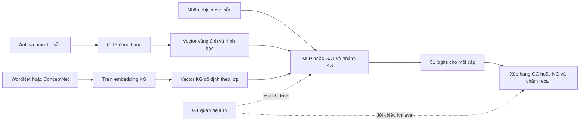

# Mức 1 — bản đồ mô hình, input/output và cách chấm điểm

Cập nhật theo code, checkpoint và report trong workspace ngày **2026-11-11**. Tài liệu này giải thích **mỗi cấu hình được train để trả lời câu hỏi gì**, giúp đọc các kết quả đã có. “Bước 1” ở đây là toàn bộ **Mức 1: học quan hệ trong ảnh**, gồm MLP, GAT và bổ sung KG.

Các mục 1–4 giải thích lỗi relation-prior và bài toán. Mục 5–8 phân loại thí nghiệm. Cuối file có kết quả và đường dẫn checkpoint theo seed. Trong lượt kiểm tra này chỉ đọc artifact và viết tài liệu; không train thêm hoặc sửa checkpoint.

## 1. Sáu checkpoint relation-prior đang có vấn đề gì?

### 1.1. Relation-prior là nhánh nào?

Nhánh này lấy **điểm quan hệ từ ConceptNet TransE** làm đặc trưng bổ sung cho mô hình dự đoán quan hệ ảnh. Ví dụ, với hai lớp đối tượng, nó tạo một vector điểm cho 10 loại quan hệ ConceptNet: `IsA`, `PartOf`, `HasA`, `MadeOf`, `UsedFor`, `CapableOf`, `AtLocation`, `HasProperty`, `ReceivesAction`, `RelatedTo`.

Vector 10 điểm này đi qua một mạng học được để điều chỉnh **51 logits của bài toán VG150**. Mười quan hệ ConceptNet không phải 50 predicate VG150; không có phép đồng nhất nhãn trực tiếp như `HasA = has` trong code.

Hai cấu hình là `relation_real` và `relation_shuffled`, mỗi cấu hình train với seed 42, 123, 3407: **2 × 3 = 6 checkpoint**.

### 1.2. Bất nhất nằm giữa train TransE và xuất đặc trưng

TransE học vector entity và relation sao cho, với triple đúng `(h, r, t)`, vector `e_h + e_r − e_t` có khoảng cách nhỏ.

| Công đoạn | Code đang dùng | Ý nghĩa |
|---|---|---|
| Train TransE | `p=1`, tức L1 | Cộng giá trị tuyệt đối của các thành phần: `Σ |d_j|` |
| Xuất relation scores | `.norm(dim=-1)`, mặc định L2 | Căn tổng bình phương: `sqrt(Σ d_j²)` |
| Đưa vào PredCls | Điểm âm của khoảng cách L2, chuẩn hóa riêng từng quan hệ | Càng gần thì điểm trước chuẩn hóa càng cao |

Nguồn: [lớp TransE](../src/knowledge/transe/core.py), [trainer khởi tạo TransE](../scripts/train_transe.py), [export relation scores](../src/knowledge/pair_relation.py).

**L1 và L2 có thể đảo thứ hạng**, không chỉ đổi đơn vị. Ví dụ minh họa hai vector sai lệch, không phải dữ liệu thực của checkpoint:

| Ứng viên | Vector sai lệch | L1 | L2 |
|---|---|---:|---:|
| A | `(3, 0)` | **3** | 3 |
| B | `(2, 2)` | 4 | **2,828** |

L1 ưu tiên A vì 3 < 4; L2 ưu tiên B vì 2,828 < 3. Vì vậy không thể coi điểm L2 xuất ra là đúng hàm chấm đã dùng để train TransE L1.

Đừng nhầm **chuẩn hóa độ dài entity về 1 bằng L2** với **dùng L2 để đo sai lệch triple**: đây là hai thao tác khác nhau. Lỗi đang xét là thao tác đo sai lệch triple trong exporter.

### 1.3. Đã kiểm chứng gì trên artifact thật?

- Tính lại tensor chuẩn hóa từ entity/relation đã lưu: dùng L2 khớp artifact **tuyệt đối**, max absolute difference = **0,0**; dùng L1 cho sai khác lớn nhất **2,1347661**. Con số này là độ lệch đặc trưng chuẩn hóa, **không phải điểm phần trăm recall**.
- Đã kiểm lại cả sáu checkpoint: hash khớp danh sách đã khóa; buffer `kg_relation_scores` đúng là tensor L2 đó sau permutation tương ứng. Đây là đặc trưng chúng đã dùng khi train.
- Manifest xuất đặc trưng ghi rõ `negative_l2(...)`. Không thấy checkpoint hỏng hoặc phát sinh NaN; vấn đề là **không nhất quán với hàm khoảng cách TransE đã train**.

Nguồn artifact: [manifest relation scores](../data/knowledge/c2-conceptnet-relation-scores-toan-v1/manifest.json), [audit](experiments/level1_audit_2026-11-11.md), [danh sách sáu checkpoint](../reports/level1/submission/excluded-relation-prior.json).

### 1.4. Ảnh hưởng và hướng xử lý

**L2 không phải phép đo sai trong mọi thiết kế.** Có thể giữ nó như một đặc trưng L2 có chủ đích và mô tả đúng. Nhưng các run hiện tại chưa chứng minh lợi ích của relation-prior dùng đúng scoring L1 của TransE, nên sáu run được để riêng khỏi bảng GC/NG chính.

Lỗi này **không lan sang nhánh ghép entity ở node, pair KG hoặc visual gate**: các nhánh đó sử dụng vector entity, không sử dụng tensor điểm quan hệ này trong forward. Model fusion có thể lưu buffer relation scores ngay cả khi mode không đọc buffer; việc buffer tồn tại trong checkpoint không đồng nghĩa nó ảnh hưởng dự đoán.

Nếu muốn thử bản nhất quán L1, quy trình là:

1. Xuất artifact **phiên bản mới** bằng L1, ghi rõ norm và kiểm tra score với TransE.
2. Giữ nguyên split, seed, loss, baseline và quy tắc shuffled để có đối chứng.
3. Train lại **sáu run PredCls relation-prior** với artifact mới; không cần train lại TransE chỉ để đổi exporter về đúng L1 đã dùng.
4. Chấm lại GC/NG và so với bản L2 cũ, baseline và shuffled tương ứng.

Không chỉ thay tensor trong checkpoint cũ rồi gọi đó là “đã sửa”: mạng downstream đã học với phân bố đặc trưng L2. Cũng chưa có bằng chứng sửa L1 sẽ làm recall tăng. **Các bước sửa/train trên chưa được thực hiện.**

## 2. Bài toán chung: input là gì, output là gì?

### 2.1. Đầu vào ở mức bài toán

Chúng ta đang làm **VG150 Predicate Classification — PredCls**. Với một ảnh, đề bài cho sẵn:

| Thành phần | Ví dụ | Dùng làm gì? |
|---|---|---|
| Ảnh RGB | Ảnh có cô gái, tóc, áo | Lấy đặc trưng thị giác của vùng đối tượng |
| Bounding box từng đối tượng | Hộp bao cô gái, hộp bao tóc | Xác định vùng ảnh và vị trí/kích thước |
| Nhãn lớp của từng đối tượng | `girl`, `hair`, `shirt` | Biết đây là những loại vật thể nào |
| Tri thức ngoài ảnh, nếu cấu hình bật KG | Vector khái niệm tương ứng với `girl`, `hair` | Bổ sung thông tin về lớp đối tượng |

**Quan hệ đúng của ảnh không được đưa vào forward như một input.** Nó được giữ riêng để tính loss khi train và đối chiếu khi eval. PredCls cho sẵn box và nhãn object, nhưng **không cho sẵn những cặp nào có quan hệ**.

Với N đối tượng, mô hình chấm tất cả **N × (N−1) cặp có hướng**, không lấy cặp một đối tượng với chính nó. `girl → hair` và `hair → girl` là hai cặp khác nhau. Ví dụ N=3 có 6 cặp; N=8 có 56 cặp.

### 2.2. Input thực sự đi vào code

Các run CLIP không đọc lại JPEG trong mỗi bước train. Vùng ảnh đã được mã hóa trước bằng **CLIP ViT-B/32 đóng băng** và lưu cache. Đối với một object:

| Thành phần vector | Số chiều | Có học tiếp khi train PredCls? |
|---|---:|---|
| Tâm x, tâm y, chiều rộng, chiều cao, diện tích box; chuẩn hóa theo kích thước ảnh | 5 | Không; tính từ box |
| CLIP của vùng object | 512 | Không; vector cache cố định |
| Embedding nhãn object | 32 | **Có**; bảng embedding học từ nhiệm vụ PredCls |
| Embedding KG, nếu dùng | 64 | Không; đã train riêng trên KG rồi đóng băng |
| Bit báo object có mapping KG hợp lệ | 1 | Không |

Tên config `geometry_dim=517` trong các run CLIP thực ra bao gồm **5 hình học + 512 thị giác**. Tensor `x` có shape `[N, 517]`; nhãn object được truyền riêng, rồi model tra embedding 32D. GAT thường ghép thành 549D trước phép chiếu. GAT ghép KG ở node dùng 614D = 517 + 32 + 64 + 1.

Các tensor liên quan:

| Tensor | Shape | Nội dung |
|---|---|---|
| `x` | `[N, 517]` trong run CLIP | Hình học + vector vùng ảnh |
| `object_labels` | `[N]` | ID lớp object trong 150 lớp |
| `edge_label_index` | `[2, E]` | Các cặp subject/object cần dự đoán |
| `edge_index` | `[2, E_message]` | Cạnh cho GAT truyền thông tin; tạo độc lập với predicate GT |
| `boxes` | `[N, 4]` | Box XYXY dùng tính đặc trưng/matching |
| `gt_relation_index`, `gt_predicate` | `[2, M]`, `[M]` | M dòng annotation quan hệ, dành cho supervision/evaluation |

Một lớp như `girl` có cùng vector KG ở mọi ảnh; hai cô gái khác nhau vẫn có crop CLIP và box khác nhau. KG theo lớp không nói chính xác cô gái cụ thể đang làm gì trong ảnh cụ thể.

Nguồn: [graph builder](../src/graph/builder.py), [geometry](../src/features/geometry.py), [visual features](../src/features/visual.py), [MLP](../src/models/mlp_semantic.py), [GAT](../src/models/gat.py).

### 2.3. Output trước và sau bước xếp hạng

**Output thô của mọi model PredCls hiện tại là `[E, 51]` logits**: mỗi cặp có 51 điểm chưa chuẩn hóa, gồm 50 predicate và 1 lớp background. Softmax trên cả 51 lớp chuyển chúng thành phân bố điểm cho mỗi cặp.

Ví dụ cho một cặp, sau softmax:

```text
girl → ? → hair
with: 0,50; has: 0,35; background: 0,05; các predicate khác cộng lại: 0,10
```

Model có điểm cho cả `with` lẫn `has`. Việc giữ một hay nhiều predicate xảy ra ở **bước chọn ứng viên để đánh giá**, không phải do model chỉ tạo một con số.

Output dùng để chấm là danh sách bộ ba có điểm, chẳng hạn:

```text
(girl_node_1, with, hair_node_3, score=0,50)
(girl_node_1, has,  hair_node_3, score=0,35)
```

Đây là quan hệ giữa **các instance cụ thể trong ảnh**, không chỉ giữa hai tên lớp. Ở Mức 1, hệ thống dự đoán quan hệ; chưa tạo ảnh chỉnh sửa hoặc thực hiện hành động chỉnh sửa scene graph của Mức 2–3.

## 3. Khi nói “train model” thì những gì được học?

Có hai quá trình train khác nhau:



CLIP đã được tiền huấn luyện bên ngoài; dự án dùng nó để trích vector, không train lại CLIP. Các trọng số MLP/GAT, embedding nhãn object, head dự đoán và gate/correction của nhánh KG được học trên train VG150. KG là nhánh tùy chọn; baseline MLP/GAT không lấy input từ ô “Vector KG”.

### 3.1. Nhãn supervision của PredCls hiện tại

| Tình huống một cặp trong train | Target | Cách dùng |
|---|---:|---|
| Có đúng một predicate khác nhau | ID 1–50 | Cặp dương để học |
| Không có annotation quan hệ | 0 | Background; lấy mẫu làm cặp âm |
| Có từ hai predicate khác nhau | −1 | **Bỏ qua khi tính loss hiện tại** |

Các annotation lặp cùng một predicate không biến cặp đó thành đa nhãn khác nhau. Mỗi bước train dùng các cặp dương không mơ hồ và tối đa **3 cặp background cho mỗi cặp dương**; ảnh không có cặp dương dùng được sẽ bị bỏ qua. “Không có annotation” không chứng minh chắc chắn quan hệ không tồn tại ngoài đời.

Trong toàn train, 16.894 cặp dương đa predicate bị loại, chứa 48.516/405.860 annotation, tức **11,95% annotation**. Khi eval, GT vẫn giữ các quan hệ này. **Bổ sung NG evaluation chưa thay đổi loss thành multi-label và chưa khắc phục phần supervision bị bỏ qua.**

Nguồn: [builder](../src/graph/builder.py), [sampling](../src/training/sampling.py), [audit](experiments/level1_audit_2026-11-11.md).

### 3.2. CE và loss điều chỉnh khác gì?

- `ce`: cross entropy thông thường trên logits và target của cặp.
- `logit_adjusted`: khi tính loss dùng `logits + τ × log(π)`, với **τ=0,25**; π là tần suất lớp tính từ **train**, theo chính sách lấy mẫu và cộng 1 để tránh xác suất 0. Mục tiêu là giảm thiên lệch về các quan hệ phổ biến.
- Khi inference, các run này dùng **logits trực tiếp của model**; không cộng lại phép điều chỉnh loss ở evaluator.

**Prior tần suất lớp trong loss** và **relation-prior từ ConceptNet** là hai thứ khác nhau. Bất nhất L1/L2 ở mục 1 thuộc relation-prior, không thuộc π dùng cho loss điều chỉnh.

### 3.3. Chọn checkpoint

Train = 57.723 ảnh trong split; validation = 5.000; test = 26.446. Các ma trận CLIP dùng batch train 512 ảnh, AdamW, learning rate 0,001, weight decay 0,01, early-stop patience 15. Batch 128 trong đợt chấm lại GPU là **batch evaluation**, không phải batch đã train.

`best.pt` được chọn bằng **validation mR@50 legacy**; `last.pt` để tiếp tục train. Chấm lại bằng GC/NG tham chiếu không chọn lại best epoch. Một số config cũ không ghi `max_epochs`, nên không suy ra toàn bộ ngân sách chỉ từ tên file. Chi tiết thực tế nằm trong config/history của từng run.

## 4. Chấm output như thế nào?

### 4.1. GT và annotation

**Annotation** là thông tin được gán nhãn trong dataset: box, tên object hoặc một dòng quan hệ. **GT quan hệ** là danh sách các annotation quan hệ dùng làm đáp án khi chấm.

Ví dụ minh họa, ba dòng GT của một ảnh:

```text
girl → has     → hair
girl → with    → hair
girl → wearing → shirt
```

Đây là ba quan hệ cần tìm lại. Hai dòng đầu thuộc cùng một cặp có hướng. GT thực tế cũng có thể chứa dòng lặp; evaluator reference giữ nguyên các dòng này.

### 4.2. Xếp hạng GC và NG

Softmax luôn tính cả background; background không được đưa vào danh sách dự đoán quan hệ foreground. PredCls cho sẵn object đúng, nên điểm object bằng 1; điểm xếp hạng ở đây là xác suất predicate.

| Protocol | Giữ ứng viên thế nào? | Sau đó làm gì? |
|---|---|---|
| **GC — graph constraint** | Mỗi cặp giữ đúng một predicate foreground có điểm cao nhất | Gộp mọi cặp trong ảnh, xếp giảm dần, lấy top K |
| **NG — no graph constraint** | Mỗi cặp có cả 50 predicate foreground làm ứng viên | Gộp mọi bộ ba trong ảnh, xếp giảm dần, lấy top K |

**Top K tính cho toàn ảnh, không phải cho từng cặp.** Trong NG, hai predicate của cùng một cặp chiếm hai vị trí. Không dùng GT để lọc trước “chỉ những cặp có quan hệ”. Cặp có background cao vẫn có ứng viên foreground, nhưng xác suất foreground thường thấp hơn.

### 4.3. Ví dụ tính tay với K=3

Dùng **K=3 cho dễ nhìn**; báo cáo thật dùng K=50 và 100. Giả sử điểm sau softmax đã làm tròn như sau, các ứng viên không ghi có điểm thấp hơn:

| Cặp | Predicate | Điểm | Có trong GT minh họa? |
|---|---|---:|---|
| girl → shirt | wearing | 0,60 | Có |
| girl → hair | with | 0,50 | Có |
| girl → hair | has | 0,35 | Có |
| girl → shirt | on | 0,15 | Không |
| hair → shirt | on | 0,10 | Không |

**GC:** `girl → hair` chỉ giữ `with`; `girl → shirt` chỉ giữ `wearing`. Ba dự đoán đầu là `wearing`, `with`, và `hair → on → shirt`. Tìm được 2/3 GT → **R@3 = 66,67% cho ảnh này**. `has` bị loại trước khi xếp hạng toàn ảnh.

**NG:** ba dự đoán đầu là `wearing`, `with`, `has`. Tìm được 3/3 GT → **ng-R@3 = 100% cho ảnh này**.

Cùng logits, cùng GT, khác cách lấy ứng viên. Không có lần train mới ở giữa. NG không luôn tăng recall: các predicate chưa đúng của một cặp có thể chiếm chỗ của quan hệ đúng thuộc cặp khác trong ngân sách K.

### 4.4. Một dự đoán khớp GT khi nào?

Evaluator reference đang dùng yêu cầu đồng thời:

1. Predicate ID khớp chính xác.
2. Nhãn lớp subject và object khớp, đúng hướng.
3. Box subject và box object đều có **IoU ≥ 0,5** với box GT tương ứng; IoU dùng quy ước tọa độ pixel inclusive `+1`.

IoU là diện tích phần giao chia diện tích phần hợp của hai hộp. Vì matching theo lớp và box, hai node ID khác nhau nhưng cùng lớp và hộp chồng lấp đủ cũng có thể match. Với đúng cặp node được cho sẵn, hai hộp thường trùng GT; ví dụ tính tay ở trên giả định trường hợp này.

Mỗi dòng GT chỉ tính đúng tối đa một lần trong top K, dù có nhiều dự đoán cùng match. Ngược lại, một dự đoán có thể tìm lại nhiều dòng GT trùng nhau. `has` và `with` không được tự coi là cùng nhãn vì người đọc thấy gần nghĩa; mỗi predicate chỉ khớp dòng GT có đúng predicate đó.

### 4.5. Recall và mean Recall khác nhau ra sao?

**Recall mỗi ảnh:** `số dòng GT được match trong top K / tổng số dòng GT của ảnh`.

**R@K toàn tập:** tính recall riêng từng ảnh có GT, rồi lấy trung bình các ảnh. Ví dụ ảnh A được 2/3, ảnh B được 20/20 thì R = `(2/3 + 1)/2 = 83,33%`; không phải cộng thành `22/23`.

**mR@K toàn tập:**

1. Với từng predicate c, xét riêng những ảnh có GT thuộc c.
2. Trong từng ảnh đó, lấy `số GT thuộc c được match / số GT thuộc c`.
3. Trung bình các tỷ lệ trên để được recall của c.
4. Trung bình recall của **đủ 50 predicate**; predicate không xuất hiện trong tập đánh giá đóng góp 0.

Ví dụ nhỏ chỉ có hai lớp để giải thích phép trung bình: `on` ở ảnh A tìm được 9/9, ảnh B 0/1 → recall lớp `on` = 50%, **không phải 90%**. Lớp `holding` chỉ có ở ảnh A và được 1/1 → 100%. Nếu toy vocabulary có đúng hai lớp thì mR = 75%. VG150 thực tế trung bình trên 50 lớp, không dùng mẫu số 2 này. Validation hiện tại có GT của 49 lớp, nhưng mẫu số vẫn là 50.

NG dùng cùng cách matching và trung bình, chỉ đổi danh sách dự đoán: tên chỉ số là **ng-R@K, ng-mR@K**. mR giúp mỗi lớp quan hệ có trọng số ngang nhau, để các lớp phổ biến không lấn át toàn bộ kết quả. **mR@50 = 25% không có nghĩa là 25% dự đoán trong top 50 đúng**; đó cũng không phải accuracy.

### 4.6. Ví dụ thật: miss05 — ảnh 3

Checkpoint GAT+CLIP seed 42; cặp node `girl_1 → hair_3` có các dòng GT:

```text
has, has, with, with
```

- GC giữ `with` hạng 5: tìm lại hai dòng `with`, bỏ lỡ hai dòng `has`.
- NG có `with` hạng 5 và `has` hạng 7: cả hai nằm trong top 50 và tìm lại đủ bốn dòng này.
- Toàn ảnh có sáu dòng GT: **GC R@50 = 4/6**, **NG ng-R@50 = 6/6**.

Các từ trong demo:

| Từ | Đọc như thế nào? |
|---|---|
| GT đang xem | Một dòng annotation được chọn để phân tích; chưa phải toàn bộ GT của cặp/ảnh |
| Dự đoán cùng cặp | Predicate model chọn cho đúng hai node subject/object đang xét |
| Hạng GC | Vị trí của bộ ba đã giữ cho cặp trong danh sách dự đoán toàn ảnh |
| Hạng NG | Vị trí của một bộ ba cụ thể; `has` và `with` có hạng riêng |
| Matching reference đầu tiên | Hạng sớm nhất của dự đoán match dòng GT được chọn theo predicate + lớp + IoU |
| `None` cho dòng `has` | Không có matching prediction cho dòng này trong danh sách GC kiểm tra; không có nghĩa mọi quan hệ của cặp đều sai |

`miss05` là miss của **dòng has được chọn**, trong khi `with` cũng đúng GT. Xem [notebook](../notebooks/level1_reference_demo.ipynb), đổi `CASE_ID = 'miss05'`; [kết quả chạy kiểm chứng](../reports/level1/reference-comparison/demo-check.json).

### 4.7. Đọc đúng phiên bản metric

| Tên | Matching / cách trung bình | Dùng ở đâu? |
|---|---|---|
| `legacy` | Node ID chính xác; bỏ dòng GT trùng; mR gộp hit/support mỗi lớp qua tập trước khi trung bình các lớp có GT | Train cũ và chọn checkpoint; report lịch sử |
| `reference-v1` — GC | Lớp + IoU; giữ dòng trùng; image-macro theo từng predicate rồi đủ 50 lớp | Bảng chính chấm lại |
| `reference-ng-v1` — NG | Matching/trung bình giống reference-v1; cho nhiều predicate/cặp vào ranking | Bảng bổ sung chấm lại |

Không so trực tiếp số mR legacy với reference, hoặc ng-mR với mR GC để kết luận mô hình nào tốt hơn. Chi tiết và lệnh chạy: [PredCls.md](evaluation/PredCls.md).

## 5. Tại sao có nhiều “model” như vậy?

Một **kiến trúc** như GAT có nhiều **cấu hình thí nghiệm**: bật/tắt KG, đổi nguồn KG, đổi loss. Mỗi cấu hình chạy ba seed tạo ba **run**. Mỗi run lại có `best.pt`, `last.pt`, đôi khi nhiều `epoch_*.pt`. Những file đó không phải từng ấy kiến trúc khác nhau.

| Nhóm CLIP hiện tại | Cấu hình | Seed mỗi cấu hình | Checkpoint best đã train | Được dùng trong bảng GC/NG mới |
|---|---:|---:|---:|---:|
| A. Baseline và KG ghép ở node | 9 | 3 | 27 | 27 |
| B. KG theo cặp × loss | 4 | 3 | 12 | 12 |
| C. Fusion và đối chứng shuffled | 7 | 3 | 21 | 15 |
| **Tổng** | **20** | **3** | **60** | **54** |

54 checkpoint được eval theo hai protocol tạo **108 báo cáo**, không phải 108 model được train. Seed PredCls là 42/123/3407; dùng cùng split và cache, thay ngẫu nhiên khởi tạo/lấy mẫu. Báo cáo mean ± **độ lệch chuẩn mẫu** qua ba seed; không lấy seed đẹp nhất để đại diện.

Trong các checkpoint đã kiểm, họ GNN được dùng là **GAT**; không có run GCN hoặc GraphSAGE. TransE/RotatE/ComplEx là cách học embedding của **KG nguồn**, không phải ba GNN xử lý ảnh khác nhau.

Còn có các run không dùng CLIP và run kiểm tra kỹ thuật trước đó, được liệt kê riêng ở mục 8. Ba seed PredCls **không có nghĩa mỗi KG được train ba seed**: các nhánh chính hiện dùng chung một artifact KG nguồn đã chọn.

## 6. Các model KG được train riêng để làm gì?

Input của train KG là các triple từ **WordNet/ConceptNet**, không phải ảnh VG150. Output dùng tiếp là bảng vector entity (và vector relation khi cần). Entity đã liên kết với nhãn object được xuất thành bảng `[151, 64]`: 150 lớp object + hàng background.

| Artifact đang dùng | Model KG nguồn | Câu hỏi/mục đích | Đầu ra dùng cho PredCls |
|---|---|---|---|
| `c2-wordnet-reviewed-filtered-v2` | WordNet TransE, seed 42, best epoch 40 | Tri thức phân loại/ngữ nghĩa WordNet có giúp quan hệ ảnh? | Vector entity 64D; mapping hợp lệ 150/150 lớp |
| `c2-conceptnet-toan-v3` | ConceptNet TransE, seed 42, best epoch 5 | Đổi sang tri thức thông thường ConceptNet có hữu ích hơn? | Vector entity 64D; mapping 138/150; cũng là nguồn relation-prior L2 đang để riêng |
| `c2-conceptnet-rotate-toan-v2` | ConceptNet RotatE v2, seed 42, best epoch 36 | Đổi cách học embedding, giữ cùng KG/split, có giúp downstream? | Ghép phần thực/ảo thành 64D, chuẩn hóa; mapping 138/150 |
| `c2-conceptnet-complex-toan-v1` | ConceptNet ComplEx, seed 42, best epoch 11 | Một cách biểu diễn quan hệ KG khác có giúp downstream? | Ghép phần thực/ảo thành 64D, chuẩn hóa; mapping 138/150 |

Lớp thiếu mapping dùng vector 0 và valid bit = 0. Ở nhánh pair/visual/relation, nếu một đầu không hợp lệ thì correction bị gate về 0. Bit này giúp phân biệt “không có tri thức” với “vector hợp lệ”.

KG link prediction thường báo **MRR/Hits@K** để đánh giá xếp hạng entity bị thiếu trong triple. **MRR của KG không phải mR của PredCls**: một embedding tốt hơn ở link prediction không bảo đảm quan hệ ảnh tốt hơn. Không trộn hai bảng metric.

Nguồn: [export KG](../src/knowledge/export.py), [WordNet workflow](knowledge/c2_gat_wordnet.md), [ConceptNet TransE](knowledge/conceptnet_review_and_runs.md), [RotatE](knowledge/rotate_conceptnet_workflow.md), [ComplEx](knowledge/complex_conceptnet_workflow.md).

## 7. Hai mươi cấu hình PredCls hiện tại được train để làm gì?

Mọi dòng dưới đều output `[E, 51]` logits. Chúng khác nhau ở input bổ sung, nơi ghép tri thức, cấu trúc truyền thông tin hoặc loss. **Mỗi dòng là ba run**, không phải một run.

### A. Baseline và KG ghép ở node — 9 cấu hình, 27 run

MLP ghép đặc trưng subject/object rồi dự đoán trực tiếp. GAT cho các object trao đổi thông tin trước khi ghép hai hidden state để dự đoán. GAT dùng hai tầng, bốn head, hidden 256; graph message passing được tạo đầy đủ từ object, không tạo theo predicate GT.

| Mã | Tên trong report | Input/biến thể | Train để trả lời câu hỏi nào? | Đối chiếu phù hợp |
|---|---|---|---|---|
| A1 | `mlp_semantic` | Hình học + CLIP + embedding nhãn; không truyền message giữa node | Dự đoán bằng riêng đặc trưng của hai object đạt tới đâu? | Baseline phi đồ thị cho A2 |
| A2 | `gat` | Cùng đặc trưng; thêm GAT trước head | Có thêm ngữ cảnh từ các object khác có giúp? | A1; đây là so sánh kiến trúc, chưa tách riêng tác dụng số tham số |
| A3 | `kg_off` | Kiến trúc GAT+WordNet nhưng vector KG và valid bit bằng 0 | Nhánh có chỗ chứa KG nhưng không cung cấp tri thức đạt tới đâu? | A4 cùng kiến trúc |
| A4 | `wordnet_kg_on` | Ghép entity WordNet 64D + valid bit ở từng node trước GAT | Thông tin WordNet thêm vào object có giúp? | A3 để xem tác dụng KG; A2 để xem so baseline GAT |
| A5 | `wordnet_edges_off` | Giữ WordNet; bỏ message giữa các node | Hiệu quả đến từ vector KG hay còn cần ngữ cảnh graph? | A4 |
| A6 | `conceptnet_transe_kg_on` | Thay WordNet bằng entity ConceptNet TransE | Đổi nguồn tri thức sang ConceptNet có giúp? | A4 và A2; độ phủ mapping cũng thay đổi |
| A7 | `conceptnet_transe_edges_off` | Giữ ConceptNet TransE; bỏ message giữa các node | Message passing có giúp khi đã có ConceptNet? | A6 |
| A8 | `conceptnet_rotate_kg_on` | ConceptNet, đổi embedding sang RotatE v2 | Cách học vector KG khác có cải thiện quan hệ ảnh? | A6; cùng nguồn KG nhưng cách embedding khác |
| A9 | `conceptnet_complex_kg_on` | ConceptNet, đổi embedding sang ComplEx | ComplEx có tốt hơn TransE/RotatE trong downstream? | A6 và A8 |

`edges_off` vẫn giữ self-loop trong GAT và vẫn dự đoán đủ cặp subject/object. Nó không xóa các quan hệ cần chấm. `kg_off` hiện tại là đối chứng của kiến trúc/bundle WordNet; không coi là đối chứng hoàn toàn khớp cho mọi phiên bản ConceptNet.

Nguồn: [MLP](../src/models/mlp_semantic.py), [GAT](../src/models/gat.py), [GAT ghép KG ở node](../src/models/gat_kg.py).

### B. KG theo cặp × loss — 4 cấu hình, 12 run

Nhóm này hỏi: “Ghép vector ở từng node có thể chưa khai thác được quan hệ; nếu xử lý **hai vector KG cùng lúc** thì sao? Và phần cải thiện đến từ KG hay chỉ từ sửa loss?”

Nhánh pair tạo vector `[k_subject, k_object, k_subject*k_object, |k_subject−k_object|, valid_subject, valid_object]` có 258 chiều, rồi dùng MLP tạo correction cho logits. Gate vô hướng học mức đóng góp cho từng cặp:

```text
logits cuối = logits GAT + gate(cặp KG) × correction(cặp KG)
```

| Mã | Tên | KG theo cặp | Loss | Train để kiểm tra điều gì? |
|---|---|---|---|---|
| B1 | `ce_off` | Tắt | CE | Mốc gốc trong chính ma trận pair |
| B2 | `ce_on` | Bật | CE | B2 − B1: chỉ bật nhánh pair KG có giúp? |
| B3 | `adjusted_off` | Tắt | Logit-adjusted | B3 − B1: chỉ sửa loss có giúp lớp quan hệ ít gặp? |
| B4 | `adjusted_on` | Bật | Logit-adjusted | B4 − B3: KG có thêm ích lợi sau khi đã sửa loss? |

Đây là thiết kế 2 × 2. Không lấy B4 so A2 rồi quy toàn bộ chênh lệch cho KG: cả cách ghép KG và loss đã khác. Nguồn: [pair model](../src/models/gat_pair_kg.py), [trainer](../scripts/train_pair_kg.py), [mô tả ma trận](experiments/level1_pair_kg_v1.md).

### C. Fusion và KG xáo trộn — 7 cấu hình, 21 run

Nhóm này hỏi: “Nếu KG giúp, có phải nhờ **mapping tri thức đúng**, hay chỉ vì thêm nhánh mạng/vector khác nhau theo lớp?” Tất cả dùng loss điều chỉnh. Trong mỗi seed, constructor tạo đủ các nhánh theo cùng thứ tự để backbone và nhánh tương ứng có khởi tạo khớp trước train.

`real` dùng đúng mapping lớp → vector đã xuất. `shuffled` tráo vector giữa 138 lớp hợp lệ, giữ valid mask và tập vector. Permutation cố định seed **20261025**, không cho lớp hợp lệ giữ nguyên vị trí. Ba seed model dùng cùng permutation này; chưa phải thử ba cách xáo trộn độc lập.

| Mã | Tên | Cách bổ sung | Train để kiểm tra điều gì? | Trạng thái |
|---|---|---|---|---|
| C1 | `baseline` | GAT, tắt correction KG | Mốc không KG trong ma trận fusion có khởi tạo khớp | GC/NG đầy đủ |
| C2 | `pair_real` | Correction/gate từ hai entity KG đúng mapping | Pair KG có hơn C1 và C3? | GC/NG đầy đủ |
| C3 | `pair_shuffled` | Cùng nhánh pair nhưng tráo mapping | C2 có thực sự cần mapping ngữ nghĩa đúng? | GC/NG đầy đủ |
| C4 | `visual_real` | Gate theo từng predicate nhìn cả hidden GAT của hai object và KG | Để ngữ cảnh ảnh quyết định dùng KG có giúp hơn? | GC/NG đầy đủ |
| C5 | `visual_shuffled` | Cùng visual gate nhưng tráo mapping | Lợi ích C4 có phụ thuộc tri thức được gắn đúng lớp? | GC/NG đầy đủ |
| C6 | `relation_real` | Vector 10 relation scores ConceptNet → correction | Điểm quan hệ có sẵn trong KG có hữu ích hơn chỉ entity vector? | **Để riêng: bất nhất L1/L2** |
| C7 | `relation_shuffled` | Cùng relation scores nhưng tráo hai trục lớp theo permutation | C6 có hơn prior bị gắn sai lớp? | **Để riêng: bất nhất L1/L2** |

Visual gate dùng correction được chặn bằng `2*tanh(...)`; relation-prior cũng có correction bị chặn và gate theo predicate. Vì vậy C4 không chỉ là C2 đổi tên. C6 dùng điểm quan hệ KG, khác π là tần suất predicate trong loss.

B3 và C1 đều là baseline không KG với loss điều chỉnh, nhưng là **run riêng ở hai ma trận**, không phải cùng checkpoint được đặt hai tên. B4 và C2 cũng là các run riêng; cần đối chiếu với baseline trong cùng ma trận trước.

Nguồn: [fusion model](../src/models/gat_kg_fusion.py), [trainer](../scripts/train_kg_fusion.py), [ma trận](experiments/level1_fusion_v1.md).

## 8. Các run lịch sử và chạy thử nằm ngoài 60 checkpoint CLIP

### 8.1. Sáu cấu hình đầy đủ chưa dùng CLIP — 18 run

| Cấu hình | Số run | Input | Mục đích ban đầu | Nơi tra cứu |
|---|---:|---|---|---|
| Geometry MLP | 3 | Chỉ hình học box, không dùng tên lớp hay pixel | Mốc tối thiểu: vị trí/kích thước tự dự đoán quan hệ được bao nhiêu? | `checkpoints/experiments/mlp_seed*/run_0001/` |
| Semantic MLP | 3 | Hình học + embedding nhãn object | Đo lợi ích tên lớp so với chỉ geometry | `checkpoints/experiments/mlp_semantic_seed*/run_0001/` |
| GAT chưa CLIP | 3 | Hình học + embedding nhãn; message passing | Kiểm tra GNN trước khi bổ sung thị giác | `checkpoints/experiments/gat_seed*/run_0001/` |
| WordNet KG-off | 3 | Hình học + nhãn; KG bị tắt | Đối chứng cho WordNet phiên bản chưa thị giác | `runs/level1/wordnet-reviewed-kg_off-seed*-v1/` |
| WordNet KG-on | 3 | Hình học + nhãn + WordNet | Thử tri thức ngoài ảnh trước CLIP | `runs/level1/wordnet-reviewed-seed*-v1/` |
| WordNet edges-off | 3 | Như KG-on nhưng không message giữa node | Kiểm tra tác dụng message passing | `runs/level1/wordnet-reviewed-edges_off-seed*-v1/` |

Các run này có kết quả **legacy**, chưa nằm trong đợt 54 checkpoint chấm GC/NG vừa rồi. Không lấy số legacy của chúng so trực tiếp với bảng reference của CLIP để kết luận CLIP giúp hay hại.

Nguồn: [baseline lịch sử](experiments/level1_baseline_verified.md), [summary MLP/GAT](../reports/level1/baselines_3seed_val5000_summary.json), [summary WordNet chưa CLIP](../reports/level1/wordnet-reviewed-ablation-3seed-val5000-summary.json). Một số tài liệu cũ còn trạng thái TODO/running tại thời điểm viết; checkpoint/report hiện tại là bằng chứng trạng thái mới hơn.

### 8.2. Các checkpoint kỹ thuật không dùng để kết luận chất lượng

| Thư mục/nhóm | Số `best.pt` hiện thấy | Dùng để làm gì? |
|---|---:|---|
| `checkpoints/batch_benchmark` | 2 | Thử tốc độ/batch size |
| Các GAT subset trong `checkpoints/experiments` | 3 | Chạy thử 256 hoặc 1.024 ảnh train trước run đầy đủ |
| `checkpoints/gpu_smoke` | 1 | Kiểm tra đường chạy GPU |
| `checkpoints/pilot` | 1 | Pilot MLP ngắn |
| `checkpoints/pilot_batched` | 2 | Pilot MLP với batching khác nhau |
| `checkpoints/pilot_cuda` | 2 | Pilot CUDA ngắn |
| `checkpoints/pilot_smoke` | 2 | Chạy thử trên subset nhỏ |
| `checkpoints/smoke_runs` | 2 | Kiểm tra train/checkpoint tách run |
| Smoke/resume trong `runs/level1` | 9 | Kiểm KG-on/off, bỏ cạnh, export, logging và resume trên 8 ảnh |
| **Tổng kỹ thuật** | **24** | Không phải 24 phương pháp mới |

Kiểm kê các `best.pt` PredCls hiện có trong `runs/level1*` và `checkpoints/`: **60 CLIP + 18 lịch sử đầy đủ + 24 kỹ thuật = 102 file best**. Đây là kiểm kê file hiện còn trong workspace, không khẳng định mọi lần từng chạy đều có best hoặc đã thành công; không đếm `last.pt` thành model mới.

### 8.3. Run KG cũ và bản không được dùng downstream hiện tại

Ngoài bốn nguồn KG chính ở mục 6, còn các thử nghiệm:

| Nhóm thư mục trong `runs` | Vai trò/trạng thái |
|---|---|
| `transe/c1-wordnet-draft-seed42`, bản `-repro`, `c1-wordnet-transductive-seed42` | Các bản KG WordNet nháp/kiểm tái lập/split trước bản reviewed-filtered; có epoch files, không phải nguồn hiện tại |
| `transe/c1-conceptnet-bounded-seed42` | Thử nghiệm ConceptNet bounded ban đầu; không phải bundle ConceptNet v3 đang dùng |
| `transe/wordnet-toan-earlystop-cpu-smoke-20261025`, `wordnet-toan-reviewed-cpu-smoke-20261025` | Kiểm tra train/export KG trên CPU, hai epoch |
| `transe/wordnet-toan-reviewed-seed42` | WordNet reviewed bản trước; hiện dùng bản `reviewed-filtered-v2` |
| `rotate/conceptnet-toan-v3-seed42` | RotatE v1, đã train nhưng kết quả validation yếu; không dùng cho PredCls chính. Nhánh A8 dùng **selfadv-v2** |
| `complex/conceptnet-toan-v3-seed42-failed-cublas-20261025-1755` | Lần chạy lỗi trước khi có epoch checkpoint; giữ log, không phải model hoàn tất |

Các thư mục `epoch_0001.pt`, `epoch_0002.pt`… của một run KG là các thời điểm trong cùng quá trình train. Không tính mỗi epoch là một model/kiến trúc nghiên cứu khác.

## 9. Kết quả hiện tại nói được gì?

Đọc bảng theo **từng cột protocol**. Bảng dưới ghi mR@50 và ng-mR@50, đơn vị %, mean ± sample std của ba seed. Số R@50/100, mR@100 và từng seed nằm trong [bảng đối chiếu đầy đủ](../reports/level1/reference-comparison/comparison.md).

| Mã | Nhóm / cấu hình | mR@50 GC | ng-mR@50 |
|---|---|---:|---:|
| A1 | main / `mlp_semantic` | 17.21 ± 1.16 | 31.37 ± 2.54 |
| A2 | main / `gat` | 19.55 ± 0.14 | 33.21 ± 0.70 |
| A3 | main / `kg_off` | 19.01 ± 0.21 | 32.18 ± 1.23 |
| A4 | main / `wordnet_kg_on` | 18.46 ± 0.65 | 31.84 ± 1.25 |
| A5 | main / `wordnet_edges_off` | 19.47 ± 1.25 | 32.47 ± 1.83 |
| A6 | main / `conceptnet_transe_kg_on` | 19.31 ± 0.59 | 31.51 ± 0.94 |
| A7 | main / `conceptnet_transe_edges_off` | 19.49 ± 0.94 | 32.58 ± 1.32 |
| A8 | main / `conceptnet_rotate_kg_on` | 18.75 ± 0.53 | 33.02 ± 0.76 |
| A9 | main / `conceptnet_complex_kg_on` | 19.05 ± 0.23 | 33.02 ± 1.90 |
| B1 | pair / `ce_off` | 19.18 ± 0.57 | 32.25 ± 0.47 |
| B2 | pair / `ce_on` | 19.75 ± 0.99 | 32.35 ± 1.49 |
| B3 | pair / `adjusted_off` | 25.80 ± 1.10 | 36.06 ± 1.18 |
| B4 | pair / `adjusted_on` | 25.97 ± 0.61 | 36.96 ± 1.31 |
| C1 | fusion / `baseline` | 25.78 ± 0.99 | 37.13 ± 1.62 |
| C2 | fusion / `pair_real` | 25.72 ± 0.30 | 37.93 ± 0.10 |
| C3 | fusion / `pair_shuffled` | 25.85 ± 0.09 | 36.62 ± 1.09 |
| C4 | fusion / `visual_real` | 25.20 ± 0.30 | 36.98 ± 0.97 |
| C5 | fusion / `visual_shuffled` | 25.97 ± 0.91 | 37.51 ± 1.16 |
| C6 | fusion / `relation_real` | Để riêng | Để riêng |
| C7 | fusion / `relation_shuffled` | Để riêng | Để riêng |

Những kết luận cần giữ đúng phạm vi:

- GC: GAT hơn MLP về mR@50 ở cả ba seed. NG: GAT vẫn hơn trung bình, nhưng một seed giảm. Câu “GAT thắng mọi seed” phải ghi rõ metric/protocol.
- Loss điều chỉnh giúp mR@50 trong cả GC và NG, cả ba seed, đồng thời giảm R@50. Đây là tác dụng của thay loss, không tự động là tác dụng của KG.
- KG thật ở pair fusion có tín hiệu tích cực trong NG: hơn shuffled **1,31 điểm ng-mR@50**, cả ba seed tăng. So baseline không KG tăng trung bình **0,80 điểm**, nhưng một seed giảm.
- Chưa có kết luận KG vượt đồng thời baseline và shuffled ổn định qua seed. Kết quả ở K=100 có thể xếp thứ tự khác K=50; không chỉ lấy ô thuận lợi nhất.
- Đây là **validation**, không phải test độc lập của các thiết kế mới. Test legacy của ma trận chính đã được xem trước khi thiết kế các nhánh sau. Không gọi mR/NG hiện tại là accuracy hoặc bằng chứng ngang SOTA.

## 10. Tra checkpoint của từng cấu hình

Mã A/B/C khớp mục 7. Mỗi ô liên kết tới `best.pt`, kèm epoch được chọn. Epoch khác nhau là bình thường do early stopping và điểm validation. Các checkpoint C6/C7 tồn tại nhưng không có kết quả reference GC/NG trong bảng mục 9.

| Mã | Cấu hình | Seed 42 | Seed 123 | Seed 3407 |
|---|---|---|---|---|
| A1 | `mlp_semantic` | [epoch 81](../runs/level1-clip-v1/clip-mlp_semantic-seed42-v1/run_0001/best.pt) | [epoch 20](../runs/level1-clip-v1/clip-mlp_semantic-seed123-v1/run_0001/best.pt) | [epoch 78](../runs/level1-clip-v1/clip-mlp_semantic-seed3407-v1/run_0001/best.pt) |
| A2 | `gat` | [epoch 45](../runs/level1-clip-v1/clip-gat-seed42-v1/run_0001/best.pt) | [epoch 45](../runs/level1-clip-v1/clip-gat-seed123-v1/run_0001/best.pt) | [epoch 85](../runs/level1-clip-v1/clip-gat-seed3407-v1/run_0001/best.pt) |
| A3 | `kg_off` | [epoch 55](../runs/level1-clip-v1/clip-kg_off-seed42-v1/best.pt) | [epoch 43](../runs/level1-clip-v1/clip-kg_off-seed123-v1/best.pt) | [epoch 60](../runs/level1-clip-v1/clip-kg_off-seed3407-v1/best.pt) |
| A4 | `wordnet_kg_on` | [epoch 26](../runs/level1-clip-v1/clip-kg_on-seed42-v1/best.pt) | [epoch 48](../runs/level1-clip-v1/clip-kg_on-seed123-v1/best.pt) | [epoch 27](../runs/level1-clip-v1/clip-kg_on-seed3407-v1/best.pt) |
| A5 | `wordnet_edges_off` | [epoch 26](../runs/level1-clip-v1/clip-edges_off-seed42-v1/best.pt) | [epoch 108](../runs/level1-clip-v1/clip-edges_off-seed123-v1/best.pt) | [epoch 41](../runs/level1-clip-v1/clip-edges_off-seed3407-v1/best.pt) |
| A6 | `conceptnet_transe_kg_on` | [epoch 45](../runs/level1-clip-conceptnet-v1/clip-conceptnet-kg_on-seed42-v1/best.pt) | [epoch 56](../runs/level1-clip-conceptnet-v1/clip-conceptnet-kg_on-seed123-v1/best.pt) | [epoch 42](../runs/level1-clip-conceptnet-v1/clip-conceptnet-kg_on-seed3407-v1/best.pt) |
| A7 | `conceptnet_transe_edges_off` | [epoch 40](../runs/level1-clip-conceptnet-v1/clip-conceptnet-edges_off-seed42-v1/best.pt) | [epoch 35](../runs/level1-clip-conceptnet-v1/clip-conceptnet-edges_off-seed123-v1/best.pt) | [epoch 29](../runs/level1-clip-conceptnet-v1/clip-conceptnet-edges_off-seed3407-v1/best.pt) |
| A8 | `conceptnet_rotate_kg_on` | [epoch 60](../runs/level1-clip-rotate-v2/clip-rotate-kg_on-seed42-v2/best.pt) | [epoch 38](../runs/level1-clip-rotate-v2/clip-rotate-kg_on-seed123-v2/best.pt) | [epoch 32](../runs/level1-clip-rotate-v2/clip-rotate-kg_on-seed3407-v2/best.pt) |
| A9 | `conceptnet_complex_kg_on` | [epoch 48](../runs/level1-clip-complex-v1/clip-complex-kg_on-seed42-v1/best.pt) | [epoch 33](../runs/level1-clip-complex-v1/clip-complex-kg_on-seed123-v1/best.pt) | [epoch 32](../runs/level1-clip-complex-v1/clip-complex-kg_on-seed3407-v1/best.pt) |
| B1 | `ce_off` | [epoch 29](../runs/level1-clip-pair-kg-v1/clip-pair-kg-ce_off-seed42-v1/best.pt) | [epoch 34](../runs/level1-clip-pair-kg-v1/clip-pair-kg-ce_off-seed123-v1/best.pt) | [epoch 28](../runs/level1-clip-pair-kg-v1/clip-pair-kg-ce_off-seed3407-v1/best.pt) |
| B2 | `ce_on` | [epoch 54](../runs/level1-clip-pair-kg-v1/clip-pair-kg-ce_on-seed42-v1/best.pt) | [epoch 58](../runs/level1-clip-pair-kg-v1/clip-pair-kg-ce_on-seed123-v1/best.pt) | [epoch 51](../runs/level1-clip-pair-kg-v1/clip-pair-kg-ce_on-seed3407-v1/best.pt) |
| B3 | `adjusted_off` | [epoch 36](../runs/level1-clip-pair-kg-v1/clip-pair-kg-adjusted_off-seed42-v1/best.pt) | [epoch 39](../runs/level1-clip-pair-kg-v1/clip-pair-kg-adjusted_off-seed123-v1/best.pt) | [epoch 34](../runs/level1-clip-pair-kg-v1/clip-pair-kg-adjusted_off-seed3407-v1/best.pt) |
| B4 | `adjusted_on` | [epoch 31](../runs/level1-clip-pair-kg-v1/clip-pair-kg-adjusted_on-seed42-v1/best.pt) | [epoch 19](../runs/level1-clip-pair-kg-v1/clip-pair-kg-adjusted_on-seed123-v1/best.pt) | [epoch 41](../runs/level1-clip-pair-kg-v1/clip-pair-kg-adjusted_on-seed3407-v1/best.pt) |
| C1 | `baseline` | [epoch 17](../runs/level1-clip-fusion-v1/clip-fusion-baseline-seed42-v1/best.pt) | [epoch 35](../runs/level1-clip-fusion-v1/clip-fusion-baseline-seed123-v1/best.pt) | [epoch 38](../runs/level1-clip-fusion-v1/clip-fusion-baseline-seed3407-v1/best.pt) |
| C2 | `pair_real` | [epoch 34](../runs/level1-clip-fusion-v1/clip-fusion-pair_real-seed42-v1/best.pt) | [epoch 26](../runs/level1-clip-fusion-v1/clip-fusion-pair_real-seed123-v1/best.pt) | [epoch 24](../runs/level1-clip-fusion-v1/clip-fusion-pair_real-seed3407-v1/best.pt) |
| C3 | `pair_shuffled` | [epoch 26](../runs/level1-clip-fusion-v1/clip-fusion-pair_shuffled-seed42-v1/best.pt) | [epoch 32](../runs/level1-clip-fusion-v1/clip-fusion-pair_shuffled-seed123-v1/best.pt) | [epoch 21](../runs/level1-clip-fusion-v1/clip-fusion-pair_shuffled-seed3407-v1/best.pt) |
| C4 | `visual_real` | [epoch 23](../runs/level1-clip-fusion-v1/clip-fusion-visual_real-seed42-v1/best.pt) | [epoch 19](../runs/level1-clip-fusion-v1/clip-fusion-visual_real-seed123-v1/best.pt) | [epoch 30](../runs/level1-clip-fusion-v1/clip-fusion-visual_real-seed3407-v1/best.pt) |
| C5 | `visual_shuffled` | [epoch 28](../runs/level1-clip-fusion-v1/clip-fusion-visual_shuffled-seed42-v1/best.pt) | [epoch 15](../runs/level1-clip-fusion-v1/clip-fusion-visual_shuffled-seed123-v1/best.pt) | [epoch 27](../runs/level1-clip-fusion-v1/clip-fusion-visual_shuffled-seed3407-v1/best.pt) |
| C6 | `relation_real` | [epoch 31](../runs/level1-clip-fusion-v1/clip-fusion-relation_real-seed42-v1/best.pt) | [epoch 29](../runs/level1-clip-fusion-v1/clip-fusion-relation_real-seed123-v1/best.pt) | [epoch 34](../runs/level1-clip-fusion-v1/clip-fusion-relation_real-seed3407-v1/best.pt) |
| C7 | `relation_shuffled` | [epoch 22](../runs/level1-clip-fusion-v1/clip-fusion-relation_shuffled-seed42-v1/best.pt) | [epoch 27](../runs/level1-clip-fusion-v1/clip-fusion-relation_shuffled-seed123-v1/best.pt) | [epoch 34](../runs/level1-clip-fusion-v1/clip-fusion-relation_shuffled-seed3407-v1/best.pt) |

Muốn hiểu nhanh một run: đọc `config.json` cùng thư mục → đọc hàng tương ứng ở mục 7 → đọc report đúng protocol. `history.json` giúp xem diễn biến train/validation; model state trong `best.pt` là trọng số thực sự dùng để eval.

## 11. Bằng chứng và giới hạn của lần kiểm tra này

- Đã đọc config/epoch từ **102 best checkpoint PredCls** hiện có, phân biệt run chính, lịch sử và kỹ thuật; đọc code model, graph builder, sampler và evaluator.
- Đã tính lại relation-score L1/L2 và kiểm buffer/hash sáu checkpoint bị để riêng. Việc xác nhận bất nhất không chứng minh nó là nguyên nhân khiến metric thấp, cũng không dự đoán lợi ích của bản sửa.
- Danh sách 54 checkpoint chính và số liệu lấy từ [bảng đối chiếu GC/NG](../reports/level1/reference-comparison/comparison.json); sáu checkpoint còn lại lấy từ [danh sách loại trừ](../reports/level1/submission/excluded-relation-prior.json).
- Đợt triển khai evaluator trước đã có **224 tests pass** và differential check với upstream trên **100 ca tổng hợp + 16 ảnh thật**, cả GC/NG. Lượt viết hướng dẫn này không chạy lại train hoặc toàn bộ evaluation.
- Mapping KG còn giới hạn đa nghĩa/độ phủ; đối chứng shuffled hiện chỉ một permutation. Các nhãn quan hệ ảnh có thể thiếu hoặc lặp. Người trong nhóm vẫn cần xác nhận phần phân tích ảnh.

Tài liệu liên quan: [báo cáo ngắn](LEVEL1_REPORT.md), [protocol chi tiết](evaluation/PredCls.md), [biên bản evaluation](../reports/level1/reference-comparison/verification.json), [notebook demo](../notebooks/level1_reference_demo.ipynb).

## 12. Đối chiếu trực tiếp với yêu cầu PDF và hướng mở rộng

Đã đọc lại đủ sáu trang [Project01_Graph_Editing.pdf](../Project01_Graph_Editing.pdf). Kết luận tại thời điểm 2026-11-11: **phần mô hình và thực nghiệm đã đáp ứng cấu trúc cốt lõi Mức 1; chưa hoàn tất toàn bộ sản phẩm nộp và phần phân tích định tính**. Điểm trần 7,0 trong đề không phải điểm được bảo đảm khi chạy đủ model.

### 12.1. Mức 1 bắt buộc: đã có gì, còn gì?

| Yêu cầu PDF | Trang | Bằng chứng hiện tại | Đánh giá |
|---|---:|---|---|
| Ít nhất một dataset; khuyến nghị VG150 PredCls | 2–3 | VG150, split train/val/test 57.723/5.000/26.446, input GT box/nhãn | Đã có |
| Ít nhất một GCN/GAT/GraphSAGE và baseline MLP phi đồ thị | 3, 5 | A1 MLP, A2 GAT, cùng input/split | Đã có; không cần train thêm cả GCN lẫn GraphSAGE |
| Liên kết nhãn với WordNet/ConceptNet, ghép TransE/ComplEx vào node | 2–3 | A4/A6/A9; vector KG ghép trước GAT; có manifest duyệt mapping | Đã có; công bố giới hạn duyệt theo lô/đa nghĩa/độ phủ |
| Ablation bỏ tri thức và bỏ hoặc xáo trộn cạnh | 3 | A3 KG-off, A5/A7 edges-off; giữ self-loop, bỏ message giữa node | Đã có. Shuffled KG ở nhóm C là đối chứng bổ sung, không thay cho ablation cạnh |
| R@50/100, mean Recall; ít nhất ba seed, mean/std | 3–5 | 54 checkpoint đủ ba seed, bảng reference GC và NG, full validation | Đã có; bảng mới là validation, không gọi là test độc lập |
| Cùng split, prior chỉ từ train, KG từ nguồn ngoài, thị giác đóng băng | 1–2, 4 | Split/hash đã audit; prior train; WordNet/ConceptNet; CLIP cache frozen | Có bằng chứng kỹ thuật trong phạm vi đã kiểm; nêu rõ giới hạn provenance/pretraining |
| Phân tích năm dự đoán đúng và năm dự đoán sai | 3, 5 | Có năm hit/năm miss theo GT và nhận xét AI, CSV reviewer vẫn trống | Chưa chốt: cần xác nhận, phân biệt sai predicate với bỏ lỡ do ranking/multi-GT |
| Code, môi trường, split và hướng dẫn chạy lại | 5–6 | Code/scripts/requirements/split/hướng dẫn và notebook chạy tại workspace | Đã có; cần kiểm máy trình bày, chưa chứng minh tái lập trên máy teammate |
| Báo cáo 12–18 trang, slide, bảng đóng góp, khai báo code/AI | 5–6 | Hiện chỉ có Markdown theo yêu cầu của nhóm; báo cáo chính sẽ tổng hợp sau | Chưa hoàn thành; không tạo thêm slide/PDF trong lượt này |
| Demo trực tiếp, video dự phòng ≤5 phút | 5 | Notebook PredCls chạy CPU đã kiểm; chưa có video | Có demo cơ bản, chưa đủ mọi sản phẩm nộp |

PDF yêu cầu **đo mức thay đổi khi thêm tri thức**, không ghi bắt buộc GNN+KG phải thắng baseline, đạt một ngưỡng mR cụ thể hay đạt SOTA. Kết quả không cải thiện vẫn có giá trị nếu thiết kế đối chứng đúng, đánh giá đúng và phân tích trung thực. Sáu run relation-prior bị để riêng không làm mất các nhánh KG hợp lệ đã đáp ứng Mức 1.

Hai điểm cần diễn giải cẩn thận khi hoàn thiện bộ nộp:

- **“Năm sai”:** miss03/miss04 đúng predicate nhưng ngoài top 50; miss05 chọn `with` cũng là GT, chỉ bỏ lỡ `has`. Chúng minh họa lỗi recall, không phải năm bộ ba dự đoán đều sai. Để phần này rõ và dễ bảo vệ, nên có thêm/chọn lại năm dự đoán top-K không match GT, kiểm tra bằng mắt, đồng thời giữ các case ranking/multi-GT thành phân tích riêng. Không tự gọi thiếu annotation là chắc chắn sai ngữ nghĩa ngoài đời.
- **Phạm vi notebook:** bảng cấp độ ở trang 3 đặt dự đoán thao tác chỉnh sửa vào Mức 2, nhưng yêu cầu notebook chung ở trang 5 lại mô tả đồ thị nguồn → thao tác → đồ thị đích. Notebook hiện tại minh họa Mức 1, chưa có chuỗi chỉnh sửa đó. Đây là điểm cần xác nhận cách áp dụng với giảng viên, không tự kết luận Mức 1 bắt buộc làm toàn bộ Mức 2.

Nếu dùng kết quả test trong báo cáo cuối, cần ghi đúng protocol. Các bảng test lịch sử đang là legacy; có thể chấm lại checkpoint đã khóa bằng reference để có số tương ứng, nhưng việc chấm lại không biến test đã xem thành holdout mới cho các thiết kế phát triển sau đó.

### 12.2. “Mở rộng Mức 1” theo đúng cột Mở rộng ở trang 5

| Hướng trong PDF | Hiện trạng | Công việc cụ thể | Có cần train mới? |
|---|---|---|---|
| Phân tích quan hệ hiếm — long-tail | **Đã hoàn tất reference GC/NG cho 54 checkpoint**; xem mục 13 | Chia head/body/tail = 10/20/20 lớp từ tần suất annotation train; có mean/std, paired delta và support từng lớp | Đã dùng report có sẵn, **không train/inference lại** |
| Zero-shot recall trên bộ ba chưa gặp | **Đã chạy 9 checkpoint fusion × đủ 5.000 ảnh validation**, cả GC/NG; xem mục 14 | Tập triple lớp chỉ từ toàn bộ annotation train; chấm GT chưa gặp, giữ ranking toàn ảnh | Đã inference GPU, **không train/chọn lại checkpoint** |
| SGCls | Chưa có thí nghiệm | Giữ GT box, nhưng nhãn object phải được dự đoán; cập nhật nguồn nhãn, mapping KG và matching | Cần pipeline/thí nghiệm riêng; không chỉ đổi tên metric hoặc chạy lại với GT object labels |

Zero-shot ở đây là triple **(lớp subject, predicate, lớp object)** chưa gặp trong annotation train, không phải node ID mới hay ảnh mới. Hai object class có thể đã gặp riêng lẻ. Nên xây tập “đã gặp” từ toàn bộ annotation train, kể cả các cặp đa predicate bị sampler bỏ qua, và công bố quy ước này. Không lọc trước prediction thành chỉ các cặp GT zero-shot: vẫn xếp top-K toàn ảnh, rồi đối chiếu các GT thuộc nhóm zero-shot. Báo số ảnh/annotation được đánh giá để tránh kết luận mạnh từ mẫu quá ít.

Một quy ước long-tail có thể dùng là head 10 / body 20 / tail 20 lớp, xếp theo tần suất **annotation train** và chốt quy tắc xử lý đồng hạng. Đây là đề xuất của nhóm, không phải số lượng nhóm bắt buộc trong PDF. Giữ đủ lớp trong mẫu số, ghi lớp vắng GT thay vì âm thầm bỏ lớp; không dùng ngưỡng tính từ validation/test.

### 12.3. Những gì đã vượt phần tối thiểu, và điều kiện điểm cộng

Đã có thêm NG evaluation, nhiều nguồn/kiểu embedding KG, loss điều chỉnh, pair/visual gating và đối chứng shuffled. Những phần này làm phân tích Mức 1 sâu hơn, nhưng **không tự động có nghĩa đã hoàn thành Mức 2 hoặc đạt điểm cộng**.

Trang 4 có mục **Cấp độ 4 — mở rộng tự chọn (+1,0–2,0)**. Hướng thuật toán (a) nêu attention/gating giữa các nguồn và yêu cầu **giả thuyết, ablation, thực nghiệm trên ít nhất hai tập công khai**. Nhóm hiện có gating và ablation trên **một tập VG150**, nên chưa đủ điều kiện thực nghiệm này. Cần trình bày giả thuyết và mức mới của đóng góp; không suy ra được điểm chỉ vì tên phương pháp giống gợi ý.

Mức 2 là phạm vi khác: ngoài ít nhất hai dataset và một phương pháp từ năm 2023 trở lại đây, đề còn yêu cầu bộ ít nhất 300 cặp biến đổi đồ thị, kiểm tay ít nhất 20 mẫu, model dự đoán thao tác và đánh giá precision/recall/F1. Chỉ thêm GQA/PSG hoặc thêm một GNN chưa hoàn thành Mức 2.

### 12.4. Thứ tự ưu tiên đề xuất

1. **Chốt phần Mức 1 còn thiếu:** nhóm xác nhận/phân tích năm đúng và năm sai rõ ràng; thử notebook trên máy trình bày. Báo cáo chính/slide/video do nhóm tổng hợp theo kế hoạch hiện tại.
2. **Long-tail theo reference GC/NG đã xong:** tổng hợp đủ 54 checkpoint từ report có sẵn; kết quả và cách đọc ở mục 13.
3. **Zero-shot recall đã hoàn tất cho C1/C2/C3 × ba seed:** baseline / pair_real / pair_shuffled, cùng pipeline và quy ước đã khóa; kết quả tại mục 14.
4. **Nếu tiếp tục nghiên cứu thuật toán:** chọn một hướng có giả thuyết cụ thể, như khôi phục supervision cặp đa predicate hoặc dùng nhiều permutation shuffled độc lập. Đây là thí nghiệm mới cần train, không chỉ thay evaluator. SGCls hoặc dataset thứ hai tùy mục tiêu mở rộng đã chọn.
5. **Relation-prior L1:** sửa và train lại sáu run nếu muốn theo đuổi chính giả thuyết relation-prior; không bắt buộc để hoàn tất Mức 1, và có thể tiếp tục loại trừ có giải thích.

Ở lượt đối chiếu PDF, các hướng trên là đề xuất. Cập nhật tiếp theo: **long-tail và zero-shot (9 checkpoint fusion) đã hoàn tất theo yêu cầu của người dùng**; SGCls và các thí nghiệm train mới vẫn chưa được thực hiện. Không cần tăng số kiến trúc chỉ để làm bảng mô hình dài hơn.

## 13. Kết quả mở rộng long-tail đã thực hiện

Đã tổng hợp đủ **18 cấu hình × 3 seed = 54 checkpoint**, cả GC/NG, từ 108 report có sẵn; không train hay inference lại. [Bảng đầy đủ](../reports/level1/long-tail-reference-v1/analysis.md) có head/body/tail ở K=50/100, paired delta từng seed và danh sách 50 predicate. [CSV từng lớp](../reports/level1/long-tail-reference-v1/per-predicate.csv) có số annotation train/validation và số ảnh validation.

- **Head:** 10 lớp phổ biến nhất, 358.780 annotation train = **88,40%**.
- **Body:** 20 lớp tiếp theo, 41.145 annotation = **10,14%**.
- **Tail:** 20 lớp ít nhất, 5.935 annotation = **1,46%**. Validation chỉ có 497 annotation tail; `flying in` không có GT validation.

Nhóm được cố định theo tần suất annotation train giảm dần, đồng hạng theo ID tăng dần. Không lấy tần suất từ val/test; đếm cả dòng trùng và cặp đa predicate. Khi đánh giá, **giữ nguyên top-K toàn ảnh**, rồi trung bình các recall theo lớp trong từng nhóm. Lớp vắng vẫn tính 0 trong mẫu số cố định. Do đó `mR toàn bộ = 0,2 × head-mR + 0,4 × body-mR + 0,4 × tail-mR`; công cụ đã kiểm đẳng thức cho cả 108 report ở K=50/100.

Kết quả cần nhớ khi giải thích mô hình:

1. **B3 − B1, chỉ đổi loss:** tail GC mR@50 tăng **3,65% → 9,79%**; tail NG tăng **12,64% → 17,19%**. Cả ba seed đều tăng ở cả hai protocol. Không gán cải thiện này cho KG.
2. **B4 − B3, thêm KG khi đã sửa loss:** tail GC giảm **9,79% → 8,51%**, nhưng tail NG@50 tăng **17,19% → 18,67%**. Ba seed NG@50 đều tăng, trong đó một seed chỉ +0,03 điểm; ở NG@100, trung bình lại giảm **28,81% → 28,30%**. Hiệu quả phụ thuộc protocol/K.
3. **C2 − C3, KG thật so shuffled:** tail NG@50 tăng **18,35% → 20,21%**, cả ba seed. Nhưng **C1 baseline đạt 20,62%**, cao hơn C2. Vì thế tăng ng-mR@50 toàn bộ của C2 so baseline chưa chứng minh nhóm tail cũng tăng; lợi ích ở K=50 đến từ head/body.

Đây là thống kê mô tả trên cùng validation; độ lệch chuẩn ba seed không phải khoảng tin cậy do lấy mẫu ảnh. Các lớp như `says` chỉ có 1 annotation/1 ảnh, `playing` có 3 annotation/2 ảnh. Cần đọc support cùng điểm, không kết luận mạnh từ vài ví dụ hiếm. [Diễn giải thêm trong báo cáo, mục 5c](LEVEL1_REPORT.md).

Chạy lại: `myenv/bin/python -m tools.analyze_level1_long_tail`. Ở mốc long-tail có **233 tests pass**, gồm 9 test mới cho long-tail; nhóm/lớp vắng/kiểu trung bình và chống dùng nhãn held-out để đếm train được kiểm tra. Sáu run relation-prior vẫn bị loại. Zero-shot được bổ sung ở mục 14; SGCls chưa triển khai.

## 14. Kết quả mở rộng zero-shot đã thực hiện

**C1 baseline / C2 pair_real / C3 pair_shuffled × ba seed** đã chạy GPU trên đủ 5.000 ảnh validation. Không train/chọn lại checkpoint. [Bảng đầy đủ và ví dụ chấm điểm](../reports/level1/zero-shot-reference-v1/analysis.md).

- Train có 29.283 bộ ba lớp khác nhau từ 405.860 annotation thô, bao gồm cặp đa predicate bị sampler bỏ qua. Validation có 1.130 annotation zero-shot / 851 tổ hợp, trên 722 ảnh; mọi thành phần đã từng gặp riêng lẻ trong train.
- Input/output không đổi. **zR@K** lấy trung bình recall GT zero-shot của từng ảnh có ít nhất một GT này; top-K vẫn xếp toàn ảnh. Khác mR theo predicate và khác pooled recall trên toàn bộ annotation.
- **NG@100:** KG thật 28,90%, baseline 28,06%, shuffled 27,36%. KG thật hơn cả hai đối chứng ở cả ba seed, trung bình +0,83 / +1,54 điểm; so baseline có một seed chỉ +0,031 điểm.
- **NG@50:** KG thật 16,98%, thấp hơn baseline 17,41% trung bình; hai seed giảm. GC không cải thiện ổn định. Có tín hiệu tích cực ở NG@100, chưa đủ để kết luận KG giúp zero-shot nói chung.
- **239 tests PASS**; khớp upstream trên 100 ca tổng hợp + 32 ảnh thật. Chín run tái lập GC/NG toàn tập cũ; kiểm độc lập từ hit/miss từng ảnh và mean/std. [Biên bản](../reports/level1/zero-shot-reference-v1/verification.json).

Chạy lại: `myenv/bin/python -m tools.level1_zero_shot --device cuda --batch-size 128`. Kết quả là hậu kiểm validation trên 9/54 checkpoint hợp lệ. Định nghĩa “chưa gặp” chỉ theo annotation train, không theo lịch sử pretraining CLIP hoặc nguồn KG. SGCls và train thêm vẫn chưa thực hiện.
