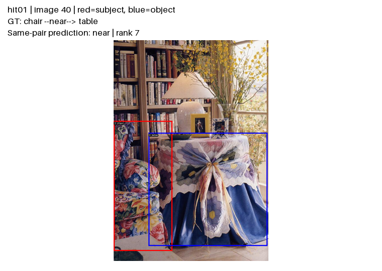
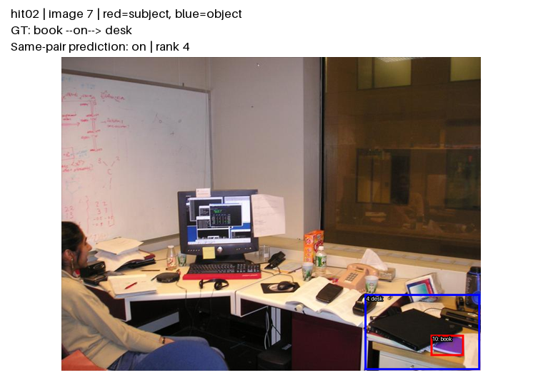
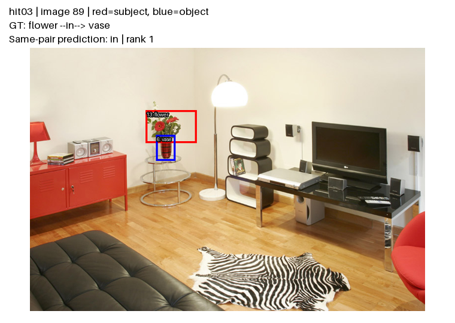
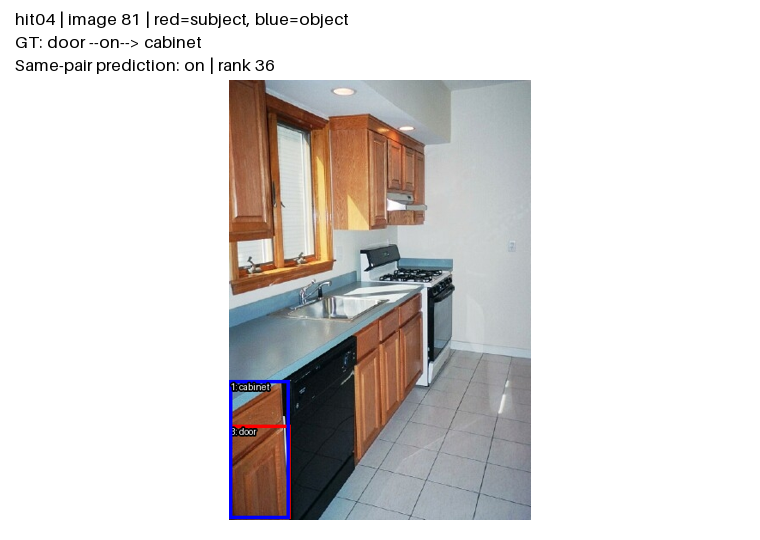
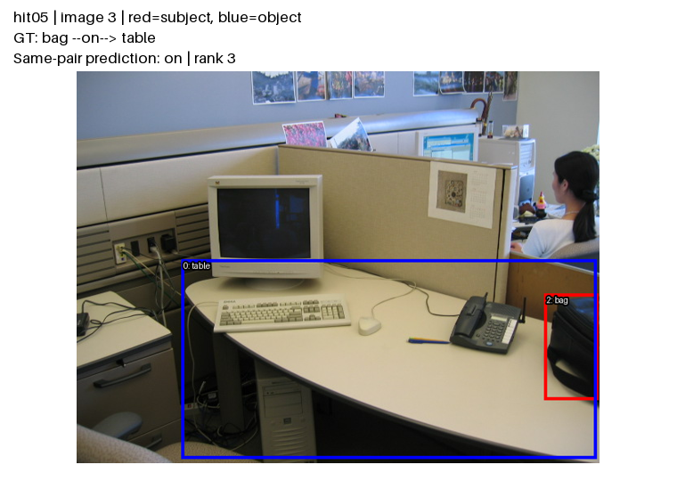
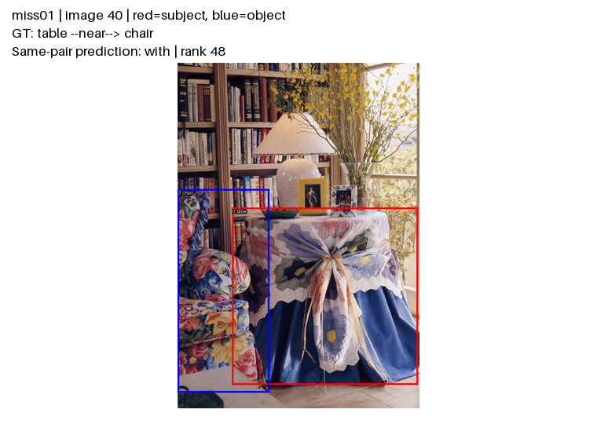
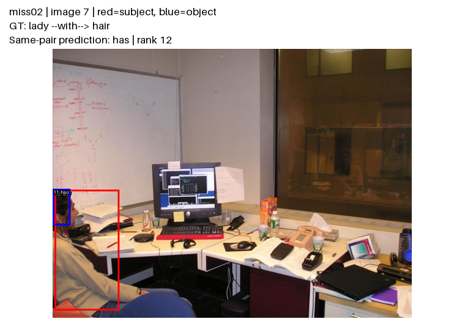
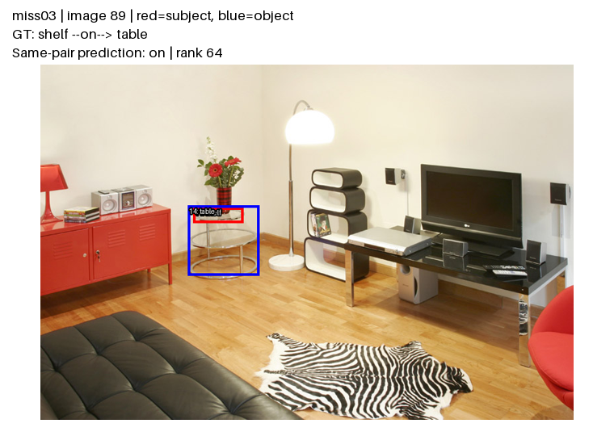
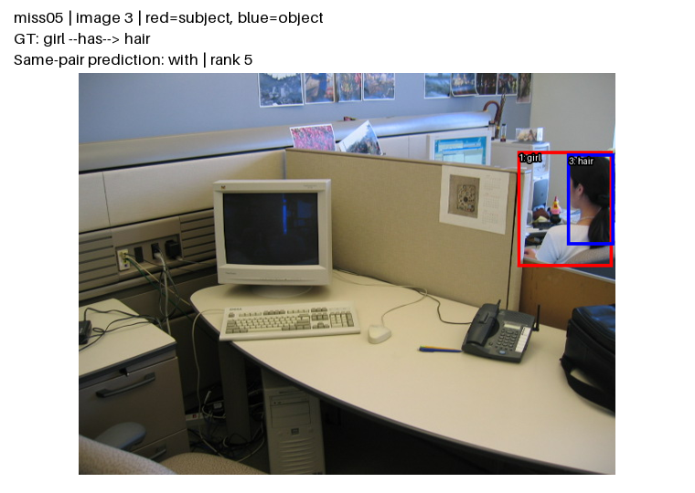

# 5 hit / 5 miss theo reference-v1

GAT+CLIP seed 42; 100 ảnh validation đầu, xáo thứ tự bằng seed 2026; lấy annotation đầu tiên của mỗi loại trên mỗi ảnh. Không chọn theo kết quả đẹp. Nhận xét dưới đây do AI quan sát ảnh; chưa được người trong nhóm xác nhận. Điền human-review.csv sau khi kiểm tra.

## hit01 — ảnh 40

GT: chair → near → table. Dự đoán cùng cặp: near; hạng 7; matching reference đầu tiên: 7.

Ghế bọc hoa ở sát bàn phủ khăn; hai hộp đúng vùng hai vật thể, nên near phù hợp với bố cục nhìn thấy. Hạng 7 cho thấy dự đoán đủ ưu tiên để vào top-50. Đây là quan hệ vị trí phổ biến, chưa chứng minh khả năng suy luận tri thức nền.

**Xác nhận người review:** chưa có.

## hit02 — ảnh 7

GT: book → on → desk. Dự đoán cùng cặp: on; hạng 4; matching reference đầu tiên: 4.

Vật thể được gán nhãn book nằm trên mặt bàn bên phải; hộp sách khá nhỏ và chứa vật màu tím. Quan hệ on phù hợp với vị trí nhìn thấy. Cần người review xác nhận nhãn book thay vì khẳng định chỉ từ hộp nhỏ; model khớp GT ở hạng 4.

**Xác nhận người review:** chưa có.

## hit03 — ảnh 89

GT: flower → in → vase. Dự đoán cùng cặp: in; hạng 1; matching reference đầu tiên: 1.

Bó hoa nằm phía trên và có cuống đi vào bình đỏ trên bàn tròn. Quan hệ flower–in–vase phù hợp ngữ cảnh chứa/đựng; hạng 1. Hộp hoa không cần nằm hoàn toàn trong hộp bình để quan hệ ngữ nghĩa in là hợp lý.

**Xác nhận người review:** chưa có.

## hit04 — ảnh 81

GT: door → on → cabinet. Dự đoán cùng cặp: on; hạng 36; matching reference đầu tiên: 36.

Hộp đỏ ở cánh tủ dưới, sát mép trái ảnh; hộp xanh bao vùng tủ lớn hơn. on ở đây mô tả gắn trên bộ phận/tủ chứ không nhất thiết tiếp xúc phía trên. Khớp hạng 36; cần giữ cách hiểu nhãn dataset và kiểm tra lại hộp bị cắt mép.

**Xác nhận người review:** chưa có.

## hit05 — ảnh 3

GT: bag → on → table. Dự đoán cùng cặp: on; hạng 3; matching reference đầu tiên: 3.

Túi đen ở mép phải nằm trên mặt bàn làm việc. Hai hộp chỉ đúng vùng túi và mặt bàn, hỗ trợ quan hệ on; hạng 3. Đây là ví dụ dễ của quan hệ đỡ/bề mặt, không đại diện mọi quan hệ hiếm.

**Xác nhận người review:** chưa có.

## miss01 — ảnh 40

GT: table → near → chair. Dự đoán cùng cặp: with; hạng 48; matching reference đầu tiên: None.

Cùng cảnh bàn và ghế ở hit01 nhưng đảo hướng cặp: GT table–near–chair, model chọn with ở hạng 48. near hợp bố cục nhìn thấy; with mô tả đồng hiện rộng hơn. Khả năng bất đối xứng giữa hai hướng cần phân tích thêm, chưa đủ để suy ra nguyên nhân ở attention.

**Xác nhận người review:** chưa có.

## miss02 — ảnh 7

GT: lady → with → hair. Dự đoán cùng cặp: has; hạng 12; matching reference đầu tiên: None.

Người ngồi bên trái và phần tóc/đầu chỉ thấy một phần. GT with, model has ở hạng 12. Hai nhãn có thể cùng hợp ngữ nghĩa sở hữu/bộ phận trong ngữ cảnh này, nhưng evaluator yêu cầu predicate ID khớp. Đây là lỗi nhãn benchmark, chưa đủ kết luận mô hình không hiểu ảnh.

**Xác nhận người review:** chưa có.

## miss03 — ảnh 89

GT: shelf → on → table. Dự đoán cùng cặp: on; hạng 64; matching reference đầu tiên: 64.

GT shelf–on–table; mô hình cũng chọn on nhưng hạng 64, ngoài top-50. Hộp subject rất mỏng gần vùng mặt bàn tròn và bình hoa; nhãn shelf khó xác nhận trực quan ở kích thước này. Lỗi đã chứng minh là ranking; độ tin cậy của nhãn vật thể cần người review.

**Xác nhận người review:** chưa có.

## miss04 — ảnh 81

GT: door → on → cabinet. Dự đoán cùng cặp: on; hạng 61; matching reference đầu tiên: 61.

Hai hộp rất hẹp ở vùng tủ trên cạnh phải; GT và model đều là door–on–cabinet, nhưng hạng 61. Đây là bỏ lỡ do cutoff top-50, không phải chọn sai predicate. Hộp nhỏ làm quan sát khó; không quy nguyên nhân chắc chắn cho CLIP hoặc GAT.

**Xác nhận người review:** chưa có.

## miss05 — ảnh 3

GT: girl → has → hair. Dự đoán cùng cặp: with; hạng 5; matching reference đầu tiên: None.

Cặp girl → hair có GT has, has, with, with. Dự đoán with hạng 5 khớp hai annotation with; case miss05 chỉ nói hai annotation has bị bỏ lỡ khi mỗi cặp giữ một predicate. Đây là trường hợp nhiều nhãn GT cùng cặp, không phải with sai GT. Khi chấm no graph constraint trên cùng logits, with hạng 5 và has hạng 7 đều vào top-50; R@50 của ảnh tăng từ 4/6 lên ng-R@50 = 6/6. Các thứ hạng này được kiểm lại bằng notebook CPU, checkpoint GAT seed 42.

**Xác nhận người review:** chưa có.
