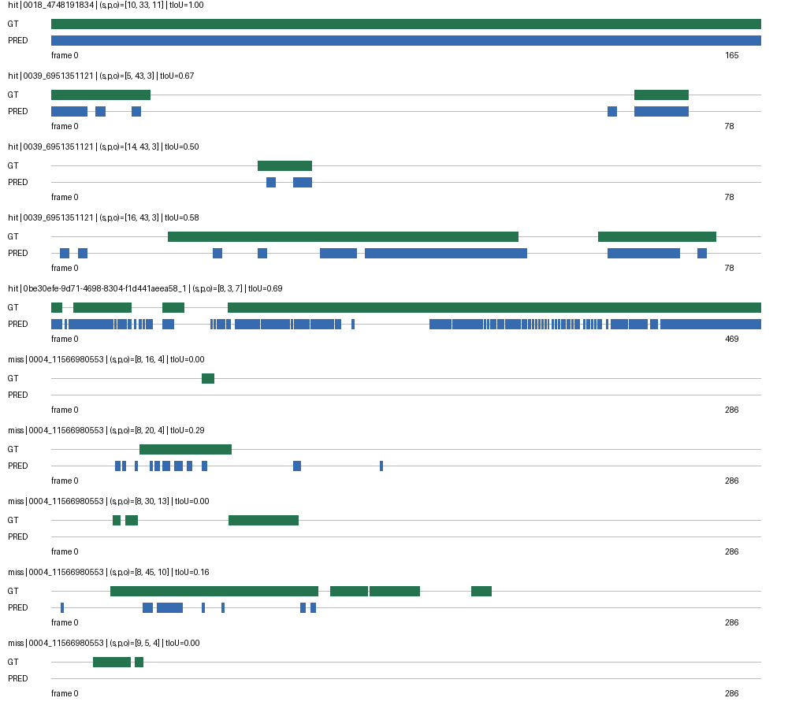

# Phụ lục M5 · Kết quả gốc và bảy cặp trước/sau

GT tracks và CLIP đóng băng. Điểm theo phần trăm, K=50 và tIoU=0,5. Checkpoint được chọn bằng validation. Thực nghiệm đo dự đoán quan hệ và thời gian trong phần mở rộng GML; phạm vi đầu vào giả định đã biết mask, lớp và ID.

| Model | mR (mean ± SD) | R (mean ± SD) |
|---|---:|---:|
| mlp | 1.62 ± 0.12 | 3.80 ± 0.43 |
| static_gat | 1.68 ± 0.17 | 3.80 ± 0.65 |
| st_gat | 0.98 ± 1.70 | 1.65 ± 2.85 |
| pvsg_conv_k5_l3 | 1.25 ± 0.25 | 8.63 ± 0.61 |
| st_no_temporal | 0.55 ± 0.95 | 1.25 ± 2.17 |
| st_no_spatial | 1.07 ± 0.70 | 3.47 ± 1.20 |
| st_no_edges | 0.00 ± 0.00 | 0.00 ± 0.00 |
| mlp_conv_k3_l2 | 1.29 ± 0.26 | 6.77 ± 0.65 |

## Kiểm tra bổ sung về hội tụ muộn

Bảy lượt được chọn sau khi xem validation vì từng dừng ở epoch 16. Bảng phía trên ghi kết quả gốc để đối chiếu với [bảng chính tính cả hội tụ muộn](final.md). Bảng dưới so từng seed khi hoãn early stopping đến ít nhất epoch 50.

| Model | Seed | mR gốc → min50 | R gốc → min50 |
|---|---:|---:|---:|
| st_gat | 17 | 0.00 → 1.87 | 0.00 → 5.26 |
| st_gat | 2026 | 0.00 → 2.31 | 0.00 → 4.73 |
| st_no_temporal | 17 | 0.00 → 1.77 | 0.00 → 4.83 |
| st_no_temporal | 2026 | 0.00 → 0.41 | 0.00 → 2.15 |
| st_no_edges | 17 | 0.00 → 1.52 | 0.00 → 3.76 |
| st_no_edges | 42 | 0.00 → 1.55 | 0.00 → 3.65 |
| st_no_edges | 2026 | 0.00 → 1.46 | 0.00 → 3.44 |

Ví dụ timeline từ Static GAT seed 17, chọn theo thứ tự video và tuple trong từng nhóm đúng/sai.

